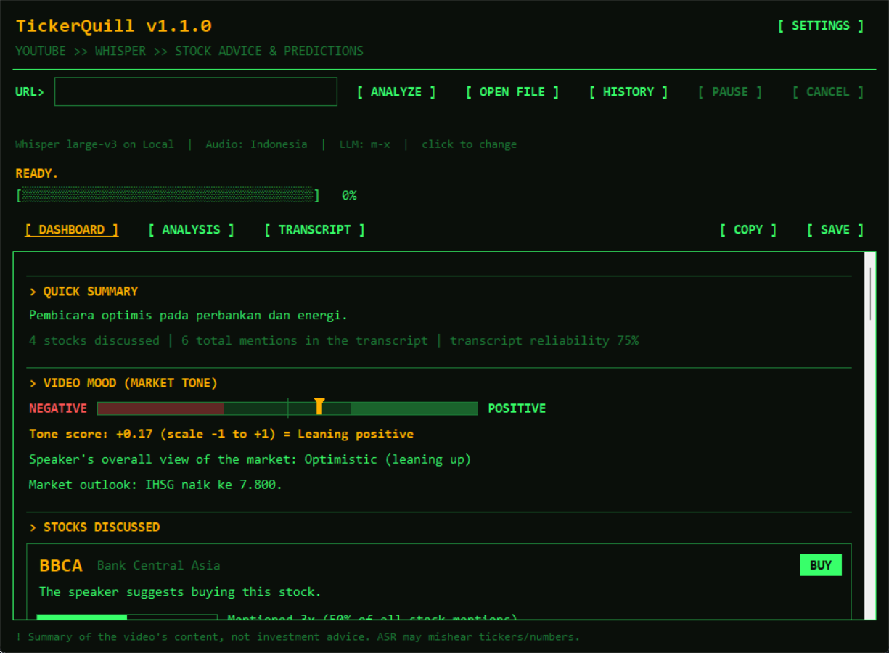
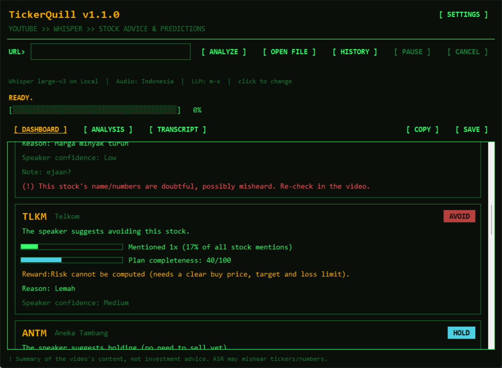
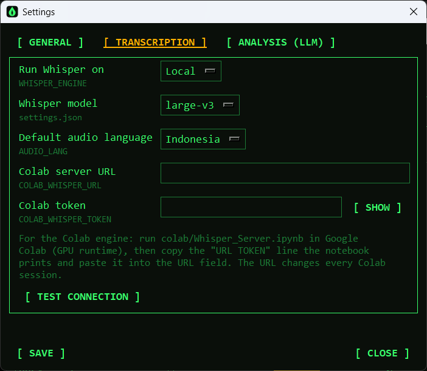

# TickerQuill

[](https://github.com/ivanpwh/TickerQuill/actions/workflows/ci.yml) [](LICENSE)

*A quill for stock videos: it listens so you can read.*

Turn a YouTube stock-market video into a structured, investor-friendly summary: what the speaker said about each stock, their stance, the price levels they mentioned, and how complete and reliable that information is.

**YouTube → Whisper (speech-to-text) → LLM (structured extraction) → local calculations → dashboard.**



> TickerQuill summarises **what a speaker said**. The analysis never uses market data; prices are fetched only when you open a stock's price window (Yahoo Finance, delayed about 15 minutes). It does not give investment advice. See [Disclaimer](#disclaimer).

## Features

**Transcription**
- Paste a YouTube URL; the audio is downloaded (yt-dlp) and transcribed with [faster-whisper](https://github.com/SYSTRAN/faster-whisper) (models `large-v3`, `medium`, `small`, `base`).
- Runs on your computer (GPU if CUDA is available, otherwise CPU) **or on a Google Colab GPU** ([guide](colab/README.md)).
- Audio languages: Auto-detect, Indonesian, English, Malay, Mandarin, Japanese, Korean, Arabic.
- Timestamps on every line (`[hh:mm:ss]`), plus automatic clean-up of Whisper's repeated "hallucination" phrases.
- **Pause, resume and cancel.** Cancelled or failed transcriptions keep a checkpoint and continue from where they stopped.
- Transcripts are cached: the same video and language is never transcribed twice unless you ask.

**Analysis**
- An OpenAI-compatible LLM extracts the market view, a list of stocks with stance (BUY / HOLD / SELL / WATCH / AVOID), reasons, expectations, price levels (entry, target, stop loss, support, resistance), and risks mentioned.
- Already have a transcript? **Open a `.txt`, `.md`, `.srt` or `.vtt` file** and skip the download and Whisper steps.
- The report can be written in Indonesian or English.

**Dashboard (all numbers calculated by the app, not by the AI)**
- Market-tone gauge (−1 to +1) weighted by how often each stock is discussed.
- One card per stock: stance badge, mention share, plan completeness (0–100), reward:risk ratio with potential gain and loss, speaker confidence, video timestamps, and warnings for doubtful names or numbers.
- Plain-language tips, a step-by-step explanation of every formula, and a glossary.

**History**
- A page (**View > History**, `Ctrl+2`) listing every transcript you have processed (including transcript files you opened), reuse it, resume unfinished ones, restart, or delete.
- The selected item shows its full title and video link, with **[ OPEN LINK ]** and **[ COPY LINK ]**.

**Market Overview** (combined dashboard)
- The start page once you have analyses (**View > Market Overview**, `Ctrl+3`), with every analysis, grouped by the video's upload date (latest analysis per video).
- Per stock across videos: consensus, disagreement flag, timeline, combined price zone with reward:risk from the medians, changes of view, reliability.
- Per date: the stocks several videos discussed that day, side by side. Overall: most-discussed stocks and market tone per date.
- Optional AI summary per stock or per date, made from the extracted data only and saved.

**Stock price window**
- Click a ticker (Dashboard card or Market Overview) for its price, change, day range and volume, and a 1D–1Y chart with the videos' buy, target and loss-limit levels drawn in.
- **Since the video**: the move from each video's date to now, and whether its target or loss limit has been reached.
- Data from Yahoo Finance (unofficial, IDX delayed about 15 minutes), fetched only while the window is open; refreshes every 60 s during IDX hours.
- **[ TRADINGVIEW ]** opens the stock on TradingView.com (`IDX:<TICKER>`) for its full charting tools.
- **[ CANDLE CHART ]** opens a TradingView-style candlestick window (TradingView Lightweight Charts™) with volume, the videos' levels as price lines and each video's stance marked on its date.

**Settings and themes**
- A tabbed **Settings** dialog for language, theme, Whisper engine/model/audio language, Colab server and LLM endpoint/key/model; changes apply immediately.
- Themes: Retro Green, Retro Amber, Modern Dark, Light, Follow system.
- Interface in Indonesian or English.

**Export**
- Copy or save the dashboard, analysis (Markdown) or transcript (text).



## How it works

```
YouTube URL
   │  1/3  yt-dlp: fetch video info, download audio            (your computer)
   ▼
audio ──► 2/3  Whisper: speech → timestamped text              (your computer, or Google Colab GPU)
   │            cached per video + language, checkpointed
   ▼
transcript ─► 3/3  LLM: transcript → JSON (stocks, stances, levels, risks)
   ▼
report.py: mentions, tone score, completeness, reward:risk, reliability, tips
   ▼
Dashboard · Analysis (Markdown) · Transcript
```

Details: [Architecture](docs/architecture.md) · [Methodology](docs/methodology.md).

## Requirements

- **Windows** (developed and tested on Windows 11). macOS/Linux: see [Other platforms](#other-platforms).
- **Python 3.10 or newer** with Tk (included in the standard Windows installer). Only Python 3.11 has been tested.
- An **OpenAI-compatible LLM endpoint** and API key for the analysis step. The app was developed against a local 9router proxy (`http://localhost:20128/v1`); any endpoint that supports chat completions with streaming should work, but only 9router has been used so far. Transcription works without it.
- Disk space for the Whisper model (`large-v3` is about 3 GB) and downloaded audio.
- Optional, for the candle chart window: `pywebview` (in `requirements.txt`) and the Microsoft Edge WebView2 Runtime (built into Windows 11; a free download for Windows 10). The rest of the app works without them.
- Optional: an NVIDIA GPU with CUDA for fast local transcription, or a Google account for the Colab engine (free-tier GPU availability varies).

## Installation (Windows)

```powershell
git clone https://github.com/ivanpwh/TickerQuill.git
cd TickerQuill
python -m venv .venv
.venv\Scripts\activate
pip install -r requirements.txt

copy .env.example .env      # then add your API key (or do it later in Settings)
```

Start the app:

```powershell
.venv\Scripts\python.exe app.py      # with a console, useful for error messages
run.bat                              # no console window
```

The first transcription downloads the selected Whisper model, which can take a few minutes.

## Quick start

1. Open **Tools > Settings** (`Ctrl+,`) **> ANALYSIS (LLM)**, enter your endpoint URL, API key and model (**[ PICK MODEL ]** lists the models your endpoint offers), then **[ SAVE ]**.
2. Paste a YouTube URL into the **URL>** field and press **[ RUN ]**.
3. Watch the progress bar: *fetch info → download audio → transcribe → analyse*.
4. The **DASHBOARD** tab opens when the analysis finishes. **REPORT** shows the Markdown report, **TRANSCRIPT** the full text. The dashboard and report start with the video title and a clickable link.
5. Use the copy and save buttons to export the tab you are viewing. They name that tab, for example **[ COPY TRANSCRIPT ]**.

Full walkthrough: [User guide](docs/user-guide.md).

## Main window

The window has three pages, **Analysis**, **History** and **Market Overview**, switched from the **View** menu (`Ctrl+1`, `Ctrl+2`, `Ctrl+3`); Market Overview is the start page once you have analyses. Settings open in a separate dialog.

| Menu | Items |
|---|---|
| **File** | Open file… `Ctrl+O` · Copy {tab} `Ctrl+Shift+C` · Save {tab}… `Ctrl+S` · Exit |
| **View** | Analysis `Ctrl+1` · History `Ctrl+2` · Market Overview `Ctrl+3` · Dashboard / Report / Transcript · Theme · Language |
| **Job** | Run `Enter` · Pause / Resume · Cancel `Esc` |
| **Tools** | Settings… `Ctrl+,` · Pick model… · Test Colab connection |
| **Help** | User guide · About TickerQuill |

Analysis page:

| Control | What it does |
|---|---|
| **URL>** | YouTube video URL (`watch?v=`, `youtu.be/`, `shorts/`, `live/`, `embed/`) |
| **[ RUN ]** | Run the whole pipeline. Press **Enter** in the URL field for the same effect |
| **[ OPEN FILE ]** | Analyse an existing transcript file (`.txt`, `.md`, `.srt`, `.vtt`) |
| Grey summary line | Shows the Whisper, audio and LLM choices; click it to open Settings |
| **[ PAUSE ] / [ RESUME ]** | Next to the status line. Pause during download, model load or transcription |
| **[ CANCEL ]** | Next to the status line. Stop the current job (transcription progress is kept) |
| **DASHBOARD / REPORT / TRANSCRIPT** | The three result views |
| **[ COPY … ] / [ SAVE … ]** | Copy or save the current view; the label names it (DASHBOARD, REPORT or TRANSCRIPT) |

While a job runs and another page is open, the title row shows its progress (for example `● 2/3 TRANSCRIBING 45%`), then `✓`, `■` (cancelled) or `!` (error) when it ends. Click it to return to the Analysis page.

## Settings

Open **Tools > Settings** (`Ctrl+,`). Everything is applied as soon as you press **[ SAVE ]**.

| Tab | Options |
|---|---|
| **General** | App language (ID/EN), theme |
| **Transcription** | Whisper engine (Local/Colab), Whisper model, default audio language, Colab URL and token, **[ TEST CONNECTION ]** |
| **Analysis (LLM)** | Endpoint URL, API key (masked), model, **[ PICK MODEL ]** |

Values are stored in `.env` (secrets and defaults) and `settings.json` (theme, Whisper model and choices made in the app). Reference: [Configuration](docs/configuration.md).



## Running Whisper on Google Colab

Local CPU transcription of a one-hour video can take a long time. The Colab engine sends compressed audio (about 14 MB per hour) to a Whisper server running on a Colab GPU and streams the text back, so progress, pause/cancel and resume keep working. The YouTube download still happens on your computer.

**You need:** a Google account, a browser, and this app already installed and working (see [Installation](#installation-windows)). No Colab account upgrade is required, but free-tier GPU availability varies.

### Part 1: start the server in Colab

1. **Open Colab.** Go to <https://colab.research.google.com> and sign in with your Google account.
2. **Load the notebook.** Quickest: click [](https://colab.research.google.com/github/ivanpwh/TickerQuill/blob/main/colab/Whisper_Server.ipynb) and skip to step 3. Otherwise, in the "Open notebook" window choose the **Upload** tab (or use **File > Upload notebook** if a notebook is already open), then select `colab/Whisper_Server.ipynb` from the app folder. It opens with four cells: instructions, install, server file and start.
3. **Turn on the GPU.** Menu **Runtime > Change runtime type**, pick **T4 GPU**, **Save**. The top-right corner should now show the GPU runtime. (The install cell also prints a warning if no GPU is attached.)
4. **Run everything.** Menu **Runtime > Run all** (or `Ctrl+F9`). If Colab warns that the notebook was not authored by Google, review it and choose **Run anyway**.
5. **Wait a minute or two (longer on a slow connection).** The cells install the packages, write the server file, start the server and open a tunnel. You can scroll to the last cell to watch.
6. **Copy the connection line.** The last cell prints something like:

   ```
   Paste this line into TickerQuill > Settings > Transcription > Colab server URL:

   https://random-words-here.trycloudflare.com Ab3dEf...token...

   Server running. Leave this cell running; press Stop when you are done.
   ```

   Select the **whole line** (the address, a space, then the token) and copy it. The cell then keeps running; that is expected. **Leave it running** and keep the Colab tab open while you use the app.

### Part 2: connect the app

7. Start TickerQuill and open **Tools > Settings** > **TRANSCRIPTION** tab.
8. Set **Run Whisper on** to **Colab**.
9. Click the **Colab server URL** field and **paste** the line you copied. The token field fills in automatically when you save or test.
10. Press **[ TEST CONNECTION ]**. A successful test shows:

    ```
    Connected. Device: cuda, status: ok.
    ```

    `Device: cuda` means the GPU is in use. `Device: cpu` means the runtime has no GPU (go back to step 3).
11. Press **[ SAVE ]**. The grey summary line on the main window should now read `Whisper large-v3 on Colab | …`.
12. Optional: choose the **Whisper model** and **Default audio language** on the same tab, then **[ SAVE ]** again. `large-v3` is a good choice on a T4 GPU.

### Part 3: transcribe

13. Back on the main window, paste a YouTube URL and press **[ RUN ]**.
14. Watch the status line: *downloading audio → compressing audio → uploading to Colab → Colab loading Whisper model → transcribing (COLAB CUDA) → analysing*.
    - The first run in a session downloads the Whisper model inside Colab (`large-v3` is about 3 GB), so "Colab loading Whisper model" can take a few minutes. Later runs in the same session skip this.
    - Compression and upload take roughly a minute or two per hour of audio, depending on your computer and connection.
15. The dashboard opens when the analysis finishes, exactly as with the local engine.

### Each time you come back

The URL and token are **new every Colab session**. When you start a new session (or the old one timed out):

1. Run the notebook again (steps 1–6) and copy the new line.
2. In **Tools > Settings > TRANSCRIPTION** paste it into the URL field, **[ TEST CONNECTION ]**, **[ SAVE ]**.

### Stop when you are done

In Colab press the stop button on the last cell, or use **Runtime > Disconnect and delete runtime**. This frees the GPU and closes the tunnel. Switch **Run Whisper on** back to **Local** if you want to transcribe offline.

### If something goes wrong

| Symptom | What to do |
|---|---|
| *Test connection*: connection refused, timeout or `trycloudflare` not found | The last notebook cell is no longer running, or the URL is old. Run it again and paste the new line |
| `401 … wrong token` | The token belongs to a different session. Paste the new `URL TOKEN` line |
| `Device: cpu` | No GPU attached. **Runtime > Change runtime type > T4 GPU**, then run the notebook again. If Colab says no GPU is available, try again later |
| Install or server cell fails | Read the red error text; the last cell prints the server error too. Re-run all cells once; if it repeats, report the error text |
| Job stops midway ("Colab server problem") | The session ended or the tunnel dropped. Run the notebook again, paste the new line, press **[ RUN ]** and choose **[ RESUME ]** – nothing already transcribed is lost |
| Very slow first run | The model is downloading inside Colab; wait for it |

More: [Colab guide](colab/README.md) · [Troubleshooting](docs/troubleshooting.md#colab-engine).

> **Privacy:** the audio is uploaded to your Colab session through a Cloudflare tunnel, protected by a random per-session token. Anyone who has both the URL and the token can use your session, so do not share them. Use the Local engine for audio you would not upload. Check Google's terms for how you may use Colab.

## Files the app creates

| Path | Contents |
|---|---|
| `work/` | Downloaded audio (kept so a resumed job does not download again; delete it to free space) |
| `cache/` | One JSON per video + language: finished transcripts and resumable checkpoints (this is what History lists) |
| `transcripts/` | A plain `.txt` copy of every finished transcript |
| `analyses/` | One JSON per analysis for the Market Overview page, plus saved AI summaries in `analyses/ai/` |
| `.env` | Endpoint, API key and defaults |
| `settings.json` | Theme, Whisper model, engine, Colab connection, last LLM model |

`.env` and `settings.json` contain secrets; keep them out of version control (the included `.gitignore` does).

## Limitations

- **Everything in the analysis comes from what was said.** Prices, targets and stances are the speaker's words, not market data. The price window compares them with delayed Yahoo Finance prices; it is not a trading tool and its data can be late or wrong.
- **Speech recognition makes mistakes**, especially with tickers and numbers. Doubtful items are flagged, but always re-check in the video.
- **LLM output can be incomplete.** If a reply is cut off, the dashboard shows what could be recovered and warns you; at most 12 stocks per video are extracted.
- Single job at a time; no batch or playlist support.
- Not packaged as an installer; Windows is the only tested platform.

## Other platforms

macOS and Linux have **not been tested**. The code is plain Python/Tk, so it may run (`python3 -m venv .venv && source .venv/bin/activate && pip install -r requirements.txt && python app.py`), but expect rough edges: `run.bat` is Windows-only, the UI uses the Consolas font, Tk buttons ignore custom colours on macOS, and mouse-wheel scrolling in the dashboard assumes Windows deltas. Without CUDA, local Whisper uses the CPU, which is slow for `large-v3`; consider `small`/`medium` or the Colab engine. Proper macOS support is planned.

## Project layout

```
app.py              UI (Tk), settings, pipeline (download → Whisper → LLM), history
report.py           parsing of the LLM reply, all calculations, tips, dashboard blocks
archive.py          analysis archive and cross-video calculations (Market Overview)
collection.py       Market Overview page
menus.py            menu bar
market.py           Yahoo Finance prices and price-since-video calculations
stockview.py        stock price window
chartview.py        candle chart window (separate pywebview process)
assets/             chart page and the bundled TradingView Lightweight Charts™ (Apache 2.0)
dashboard.py        scrollable dashboard view (canvas)
theme.py            colour themes and live re-colouring
textclean.py        removes repeated-phrase hallucinations from transcripts
remote.py           client for the Colab Whisper server
colab/              Colab server, notebook and its build script
docs/               user guide, configuration, methodology, architecture, troubleshooting
tests/              pytest suite (calculations, parsing, settings, themes)
.github/workflows/  CI (tests on Windows and Linux)
requirements.txt    Python dependencies (requirements-dev.txt adds pytest)
.env.example        template for .env
run.bat             Windows launcher (no console)
```

## Development

```powershell
pip install -r requirements-dev.txt
python -m pytest                      # GUI tests skip themselves when no display or Tk is available
python colab/build_notebook.py        # regenerate colab/Whisper_Server.ipynb after editing whisper_server.py
```

CI (`.github/workflows/ci.yml`) runs the tests on Windows and Linux and checks that the notebook matches `whisper_server.py`. The tests cover the calculations and parsing in `report.py`, text clean-up, settings and history helpers, and the theme engine; the download, Whisper and LLM steps are not covered by automated tests. Before opening a pull request please run the tests and, for UI changes, try the app with at least one dark and one light theme. See [Architecture](docs/architecture.md#extension-points) for how to add settings, themes and languages.

## Documentation

- [User guide](docs/user-guide.md): step-by-step usage and how to read the dashboard
- [Configuration](docs/configuration.md): every setting, environment variable and file
- [Methodology](docs/methodology.md): every formula, with worked examples
- [Architecture](docs/architecture.md): modules, data formats, threading, Colab protocol
- [Troubleshooting](docs/troubleshooting.md)
- [Colab guide](colab/README.md)
- [Changelog](CHANGELOG.md)

## Disclaimer

TickerQuill is a tool for summarising video content. Its output is **not investment advice** and may contain errors from speech recognition or from the AI model. Compare it with your own data (current prices, financial statements, news) and consider consulting a licensed adviser before making decisions.

## License

[MIT](LICENSE) © 2026 [ivanpwh](https://github.com/ivanpwh). Dependencies (faster-whisper, yt-dlp, openai and others) and the Whisper model weights are installed or downloaded separately and keep their own licenses.

The candle chart uses [TradingView Lightweight Charts™](https://www.tradingview.com/lightweight-charts/) v5.2.1, Copyright © TradingView, Inc. ([tradingview.com](https://www.tradingview.com/)), bundled in `assets/lightweight-charts/` under the Apache License 2.0 (see the `LICENSE` and `NOTICE` files there). Its attribution logo stays visible on the chart. TickerQuill is not affiliated with TradingView; market data in the app comes from Yahoo Finance, not from TradingView.
