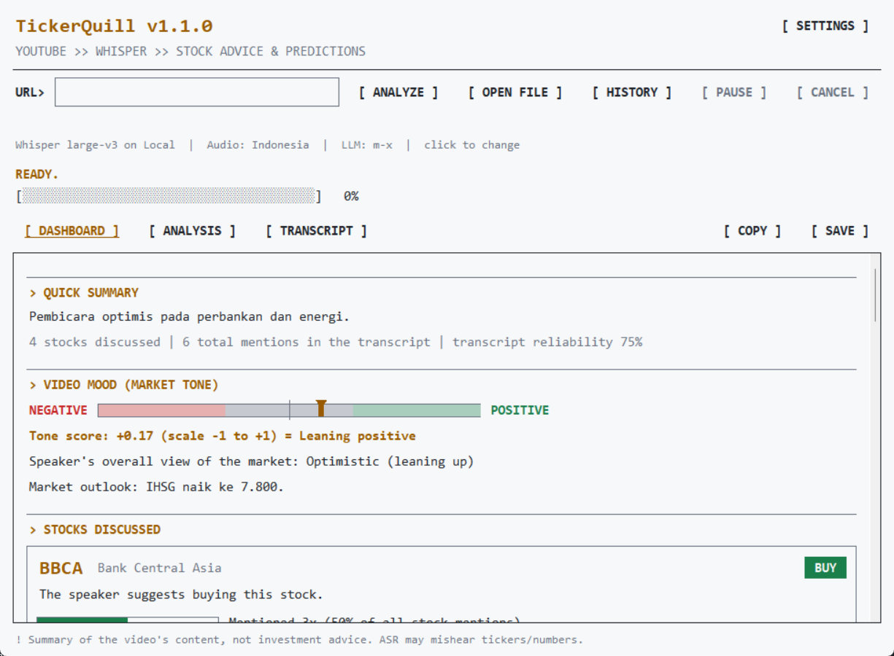

# User guide

How to use TickerQuill day to day, and how to read what it produces. For installation see the [README](../README.md).

## Contents
0. [Menus and pages](#menus-and-pages)
1. [First-time setup](#1-first-time-setup)
2. [Analysing a video](#2-analysing-a-video)
3. [When a video was seen before](#3-when-a-video-was-seen-before)
4. [Pause, cancel and resume](#4-pause-cancel-and-resume)
5. [Using your own transcript](#5-using-your-own-transcript)
6. [History](#6-history)
6b. [Market Overview](#6b-market-overview)
6c. [Stock price window](#6c-stock-price-window)
7. [Reading the results](#7-reading-the-results)
8. [Copy and save](#8-copy-and-save)
9. [Settings, language and themes](#9-settings-language-and-themes)
10. [Tips for better results](#10-tips-for-better-results)

---

## Menus and pages

The main window has three pages: **Analysis** (paste a URL, run, read the results), **History** (saved transcripts) and **Market Overview** (all analyses compared). Switch with the **View** menu or `Ctrl+1` / `Ctrl+2` / `Ctrl+3`; **Market Overview** is also an item directly on the menu bar. Once you have saved analyses, the app opens on Market Overview; before that it opens on Analysis. Each page keeps its state while you look at the other one. Settings, the model picker and confirmations open as dialogs.

| Menu | Items |
|---|---|
| **File** | Open file… `Ctrl+O` · Copy {tab} `Ctrl+Shift+C` · Save {tab}… `Ctrl+S` · Exit |
| **View** | Analysis `Ctrl+1` · History `Ctrl+2` · Market Overview `Ctrl+3` · Dashboard / Report / Transcript · Theme · Language |
| **Job** | Run `Enter` · Pause / Resume · Cancel `Esc` |
| **Market Overview** | Opens the Market Overview page (a menu-bar item, no submenu) |
| **Tools** | Settings… `Ctrl+,` · Pick model… · Test Colab connection |
| **Help** | User guide · About TickerQuill |

Items that cannot be used right now are greyed out: Run and Open file while a job runs, Pause and Cancel when nothing runs, Copy and Save when the current tab is empty or another page is open. Menu labels follow the app language. The menu bar itself uses the Windows colours; it does not follow the theme.

While a job runs and the History page is open, the title row shows the progress, for example `● 2/3 TRANSCRIBING (CUDA) 45%`. When the job ends there it shows `✓` (done), `■` (cancelled) or `!` (error) with the final status. The app never switches pages on its own; click the indicator or press `Ctrl+1` to see the result.

## 1. First-time setup

1. Start the app and open **Tools > Settings** (`Ctrl+,`).
2. **ANALYSIS (LLM)** tab: enter the endpoint URL, API key and model. **[ PICK MODEL ]** asks your endpoint for its model list; you can also type a model name directly.
3. **TRANSCRIPTION** tab: choose where Whisper runs (**Local** or **Colab**), the Whisper model and the default audio language. See the [Colab guide](../colab/README.md) if you pick Colab.
4. **GENERAL** tab: language and theme.
5. **[ SAVE ]**. Changes apply immediately.

The grey line under the URL bar always shows the active choices, e.g. `Whisper large-v3 on Local | Audio: Indonesia | LLM: … | click to change`. Click it to reopen Settings.

Without an API key the app still downloads and transcribes; it stops before the analysis step and tells you so. The transcript stays available in the **TRANSCRIPT** tab.

## 2. Analysing a video

1. Paste the video URL into **URL>**. Supported forms: `youtube.com/watch?v=…`, `youtu.be/…`, `…/shorts/…`, `…/live/…`, `…/embed/…`. Playlists are not expanded; only the single video is used.
2. Press **[ RUN ]** (or **Enter**).
3. The status line and progress bar show the stage:

| Status | Meaning |
|---|---|
| 1/3 FETCHING VIDEO INFO | Reading the title and id |
| 1/3 DOWNLOADING AUDIO | Downloading the best audio stream into `work/` |
| 2/3 LOADING WHISPER MODEL | Loading the model (the first run also downloads it) |
| 2/3 TRANSCRIBING (CPU / CUDA) | Speech-to-text; the percentage is position in the audio |
| 2/3 COMPRESSING AUDIO / UPLOADING TO COLAB / COLAB LOADING WHISPER MODEL | Colab engine only |
| 2/3 TRANSCRIPT FROM CACHE | An earlier transcript is being reused |
| 3/3 ANALYZING STOCKS | The LLM is extracting the structured report |
| DONE · CANCELLED · ERROR · PAUSED | Final or paused states |

4. When the analysis finishes the **DASHBOARD** tab opens. The transcript is available as soon as transcription ends, even if the analysis fails.

Only one job runs at a time; the buttons that would start another are disabled until it ends.

## 3. When a video was seen before

If the URL (with the selected audio language) already has a cache entry, a small line under the URL bar says so, and **[ RUN ]** asks what to do:

| Situation | Choices |
|---|---|
| Finished transcript exists | **[ REUSE ]** (go straight to analysis) · **[ TRANSCRIBE AGAIN ]** · **[ CANCEL ]** |
| Unfinished transcript exists | **[ RESUME ]** from the saved point · **[ START OVER ]** · **[ CANCEL ]** |

Reusing is much faster and is the default choice for repeat analyses, for example with a different LLM model. The cache is keyed by video and audio language, not by Whisper model.

## 4. Pause, cancel and resume

- **[ PAUSE ]** (next to the status line, or **Job > Pause**) is available while downloading, loading the model and transcribing. **[ RESUME ]** continues. Pausing a download stops it and continues from the partial file.
- **[ CANCEL ]** (or `Esc`) stops the job. If any transcript text exists it is saved as a checkpoint (written every 10 segments and on cancel or error). Press **[ RUN ]** again and choose **[ RESUME ]**.
- With the Colab engine a very long pause can drop the connection; the checkpoint still lets you resume.

## 5. Using your own transcript

Press **[ OPEN FILE ]** and pick a `.txt`, `.md`, `.srt` or `.vtt` file. The app skips download and Whisper, cleans repeated phrases and runs only the analysis. Files are read as plain UTF-8 text; subtitle formats are not parsed, so cue numbers and time ranges stay in the text. Lines in the form `[hh:mm:ss] text` (the format TickerQuill writes) give the best timestamps in the report.

The transcript is also saved to **History** as a **FILE** entry (the same content never creates a second entry), so you can analyse it again later, for example with another LLM model, without keeping the original file.

## 6. History

The **History** page (**View > History**, `Ctrl+2`) lists everything in `cache/`, newest first: status (`DONE` or percent complete), title, audio language, Whisper model and date. Transcripts you opened with **[ OPEN FILE ]** are listed too, with `FILE` in the language column and `-` as the model.

Selecting an item shows its full title and video link under the list. **[ OPEN LINK ]** opens the video in your browser and **[ COPY LINK ]** copies the link. For a `FILE` entry the line shows the original file path; COPY LINK copies the path and OPEN LINK is disabled.

| Button | Action |
|---|---|
| **[ USE / RESUME ]** (or double-click) | Resumes an unfinished transcript. For a finished one it shows the saved dashboard, report and transcript without calling the LLM; if no analysis was saved yet it says so |
| **[ REANALYZE ]** | Runs the LLM analysis again on the saved transcript (an unfinished transcript is resumed first) |
| **[ RESTART ]** | Transcribes the selected video again from scratch (for a `FILE` entry: same as USE, since there is nothing to transcribe) |
| **[ DELETE ]** | Removes the entry from the cache. The `.txt` in `transcripts/` and the audio in `work/` are kept |

History can be browsed while a job is running; choosing an item then shows "A job is already running." in red and stays on the page. The list reloads whenever the page is opened and when a job ends.

## 6b. Market Overview

The **Market Overview** page (Indonesian: **Ringkasan Pasar**; **Market Overview** on the menu bar, or `Ctrl+3`) gathers every analysis you have made and compares what different videos said about the same stock. It uses the latest analysis of each video; older analyses of the same video stay in `analyses/` but are not counted twice.

**Dates.** Videos are grouped by their **upload date**. New analyses record it automatically. Analyses made before this version (and transcript files) have no upload date yet: they use the analysis date and are marked `*`. **[ FILL IN VIDEO DATES ]** fetches the missing upload dates and channel names with yt-dlp (metadata only, no download); videos that cannot be reached are counted as failed and can be tried again later.

**Left side.** The date list (all dates, then newest first, with the number of videos) and the stocks discussed in the selected date range (number of videos, `!` when the videos disagree). Type in **FIND>** to filter.

**All dates.** Most-discussed stocks (videos, consensus, how many videos agree, `! SPLIT` for disagreement), the market tone per date (average tone score of that day's videos, −1 to +1), and the list of videos. Click a video title to open it on the Analysis page, **[ DELETE ]** to remove it from Market Overview (its transcript stays in History).

**One date.** That day's videos, the AI summary for the day, and a table of stocks discussed in more than one video that day: one stance badge per video, the consensus and the range of targets mentioned. Stocks mentioned in only one video are listed on one line.

**One stock** (click a ticker anywhere; always across all dates):

| Section | What it tells you |
|---|---|
| **Consensus** | Stance count, the majority stance and how many videos agree. A tie is shown as a tie, not as a majority. A red box appears when some videos say BUY and others SELL or AVOID |
| **AI summary** | On request (see below) |
| **Timeline** | Date, channel and title, stance, price levels as spoken, speaker confidence, `(!)` for doubtful names or numbers |
| **Combined price zone** | For buy price, target and loss limit: lowest to highest, median and how many videos stated it; numbers stated in several videos; reward:risk from the medians when loss limit < buy < target |
| **Changes of view** | Stance changes between consecutive videos, and target or loss-limit changes |
| **Reliability** | How many videos marked the stock as doubtful, and the average speaker confidence |
| **Reason per video** | Each video's reason, by date |

**AI summary.** **[ AI SUMMARY ]** sends only the extracted data shown on the page (no transcripts) to your LLM and asks for 4–8 points: what the videos agree on, where they differ, how views changed and what to re-check. The result is saved in `analyses/ai/`, so it is not requested again. When a newer analysis for that stock or date arrives, the old summary is shown with a note and **[ UPDATE AI SUMMARY ]**. The button is disabled until an LLM API key and model are set. Like everything else here, it summarises what was said; it is not investment advice.

## 6c. Stock price window

Click a **ticker on a Dashboard stock card**, or **[ STOCK PRICE ]** on a stock in Market Overview, to open its price window. Each symbol gets one window; several can be open at once.

- **Source**: Yahoo Finance, fetched only while a price window is open. It is unofficial and IDX prices are **delayed by about 15 minutes**. The ticker gets the `.JK` suffix (IDX). If the ticker was misheard, correct it in **SYMBOL>** and press **[ GO ]**; an unknown symbol is reported as not found.
- **Header**: last price, change from the previous close, day high/low, volume, the update time (WIB) and whether the IDX is open. While it is open (Mon–Fri 09:00–16:15 WIB) the window refreshes every 60 seconds; otherwise press **[ RELOAD ]**.
- **Chart**: **1D** (today, 5-minute points), **5D** (15-minute points), **1M**, **3M** or **1Y** (daily points). The labels are the same in both languages, as on TradingView. The line is green when the price rose over the range and red when it fell. Dashed lines show the buy price (amber), target (green) and loss limit (red): from that stock's card, or the medians across videos when opened from Market Overview. Levels far outside the chart's range are listed under it instead.
- **Since the video**: for each video, the close on its date (the next trading day for weekends) and the latest price, the change in %, and whether the target or loss limit has been reached since then (counting the highs and lows after the video day and the latest price). This needs the video's upload date; dates marked `*` are analysis dates (fill in upload dates on the Market Overview page), and without any date the section says so.

- **[ TRADINGVIEW ]** opens the same stock on TradingView.com (`IDX:<TICKER>`) in your browser, with its full chart tools. How current its data is depends on your TradingView account. The same button is on each stock in Market Overview.

Prices are shown for comparison with what the speaker said. They are delayed, can be wrong, and are not investment advice.

## 7. Reading the results

The dashboard and report start with the video title and its link (click it to open the video). For a transcript file the line shows the file name instead.

### Dashboard tab

| Section | What it tells you |
|---|---|
| **Quick summary** | 2–4 sentence gist of the video, then a stats line: stocks discussed, total mentions in the transcript, and **transcript reliability** |
| **Video mood (market tone)** | A gauge from NEGATIVE to POSITIVE with the **tone score** (−1…+1), the speaker's own view of the market (optimistic, pessimistic, neutral, mixed) and their market outlook |
| **Stocks discussed** | One card per stock, most-mentioned first |
| **Risks mentioned** | Risks the speaker raised, plus notes on poor transcript quality |
| **Tips for you** | Context-aware cautions (see below) |
| **Method & calculations** | How each number was produced, with this video's own values plugged in |
| **Glossary** | Ticker, entry, target, stop loss, support/resistance, reward:risk, IHSG, FOMO |

A red box at the top means the model's reply was cut off; the dashboard shows what could be recovered and the last stock may be incomplete. Press **[ RUN ]** again (the transcript is reused) or pick another model.

### A stock card

- **Ticker, name and stance badge**: click the ticker to open its [price window](#6c-stock-price-window). BUY, HOLD, SELL, WATCH or AVOID, with a one-sentence explanation. WATCH means "on the watchlist, no clear buy suggestion yet".
- **Mentioned N× (P%)**: how often the stock appears in the transcript and its share of all stock mentions. A rough measure of how much of the video was about it.
- **Plan completeness (0–100)**: 20 points each for a stated buy price, sell target, loss limit, a reason, and names/numbers that are not doubtful. A high score means the speaker gave a complete plan, not that the plan is good.
- **Levels**: buy price, sell target, loss limit (stop loss), support, resistance, exactly as spoken.
- **Reward:Risk**: computed only when buy price, target and loss limit are all stated and ordered sensibly (stop < buy < target). Shows potential gain %, potential loss % and the ratio. A ratio of 2 means the upside is twice the downside.
- **Reason / Expectation / Speaker confidence / Discussed at**: what the speaker said, how sure they sounded (Low, Medium, High) and the video timestamps to jump to.
- **(!) doubtful** warning: the name or numbers may be misheard. Replay that part of the video.

### Tips for you

Generated from the data, for example: doubtful stocks, a BUY without a stop loss, reward:risk below 1.5 or looking reasonable, a very optimistic video (FOMO warning), a negative video (do not panic-sell over one video). Position-sizing, staleness and "consult a licensed adviser" reminders are always shown. Exact rules: [Methodology](methodology.md#tips).

### Report and Transcript tabs

- **REPORT**: the same content as a Markdown-style report (summary, stocks, market outlook, risks).
- **TRANSCRIPT**: the video title and the full timestamped text, ready to copy or save.

## 8. Copy and save

The copy and save buttons act on the tab you are viewing and name it: **[ COPY DASHBOARD ]**, **[ COPY REPORT ]**, **[ COPY TRANSCRIPT ]** (Indonesian: **[ SALIN … ]** / **[ SIMPAN … ]**). The video title and link are included. The dashboard and report save as `.md`, the transcript as `.txt`. Default names are `tickerquill-dashboard.md`, `tickerquill-analysis.md` and `tickerquill-transcript.txt`.

Finished transcripts are also written automatically to `transcripts/<title>-<video id>.txt`.

## 9. Settings, language and themes

- **App language** switches the interface and the report labels between Indonesian and English. The dashboard is re-labelled immediately without calling the LLM again. Free-text parts written by the LLM (summary, reasons) stay in the language they were generated in; the language used for new analyses follows the app language.
- **Theme**: Retro Green (default), Retro Amber, Modern Dark, Light, or Follow system (checked when the app starts). The change is instant and remembered.
- Both can also be switched from **View > Theme** and **View > Language** without opening Settings.

All options: [Configuration](configuration.md).

## 10. Tips for better results

- **Pick the right audio language.** Auto-detect works, but forcing the language usually helps with tickers and numbers.
- **Bigger Whisper models are more accurate** but slower. If a job is too slow locally, try `medium`/`small` or use the Colab engine.
- **Treat "doubtful" flags seriously.** Whisper often mishears company names ("MEDCO" for MEDC) and numbers.
- **Cross-check every price level** against the video and against current market data before acting (the price window helps, but its data is delayed and unofficial).
- **Try another LLM model** if the report is empty, cut off, or the stocks look wrong. Re-running reuses the cached transcript, so it is quick.
- **Delete `work/` occasionally**; downloaded audio is kept for resuming and can grow large.
